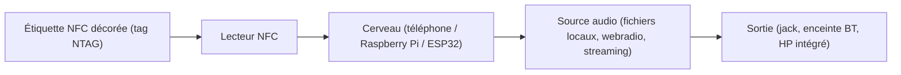

# Je Remets Le Son — Cahier des spécifications

> Boîte à musique physique pour jeune enfant : l'enfant pose une étiquette NFC décorée, la musique démarre. Objectif : autonomie sans écran, retrouver un pseudo-support physique perdu depuis le streaming.

Version 0.3 — novembre 2026. Source de vérité : dossier Google Drive « Je Remets Le Son ».

## 1. Vision et principes de conception

- **Cible utilisateur** : jeune enfant (3-6 ans), manipulation autonome, sans écran, sans lecture obligatoire de texte.
- **Geste principal** : poser une étiquette = lancer un morceau/album/playlist. En changer = poser une autre étiquette.
- **Principes** : un seul geste ; robustesse (chutes, salissures) ; volume plafonné ; démarrage instantané ; entretien facile pour les parents (associer une nouvelle étiquette doit être trivial).
- **Anti-principes** : pas d'écran, pas de compte à connecter par l'enfant, pas de dépendance fragile à une API tierce pour la fonction de base.

## 2. Architecture d'ensemble

Quatre blocs : **A** les étiquettes, **B** la lecture du tag, **C** la source musicale, **D** la sortie audio. Les blocs A et D sont simples ; C a été le principal arbitrage du projet.

## 3. Bloc A — Les étiquettes NFC

- Tags **NTAG213** (137 octets, ~0,30 €/pièce) ou **NTAG215** (504 octets). Puces autocollantes ou cartes brutes à écrire au smartphone (apps : *NFC Tools* sous Android, *NXP TagWriter*).
- **Contenu du tag : un simple identifiant**, jamais les métadonnées (pochette, titre...). Le mapping ID → contenu musical vit côté boîte, modifiable sans retoucher les étiquettes.
- Deux écoles :
  - **Utiliser l'UID du tag** (numéro de série gravé en usine) : zéro écriture, indestructible. C'est le choix de l'app dédiée.
  - **Écrire un NDEF** (texte court ou URI) : utile pour des tests sur n'importe quel téléphone ; avec une app dédiée, l'UID suffit, et MacroDroid écrit son propre payload.
- Décoration : carton plastifié, sticker imprimé ou figurine. **Pas de couche métallique au-dessus du tag** (retour d'expérience Phoniebox : une feuille d'alu au-dessus du lecteur empêche la lecture).

## 4. Bloc B — La lecture du tag

| Version | Solution | Remarques |
| --- | --- | --- |
| v0.5 (téléphone) | NFC intégré du smartphone Android | Lecture en arrière-plan native. Contrainte matérielle : l'écran doit rester allumé (écran noir possible en mode kiosque). |
| v1 (boîte) | Lecteur RFID/NFC **USB type clavier** (ex. ACR122U, 20-35 €) | Le plus simple sur Raspberry Pi : le tag est « tapé » comme du texte. Voie recommandée par l'écosystème Phoniebox. |
| v2 (objet embarqué) | Module RC522 ou PN532 en SPI/I2C sur ESP32 | Alternative GPIO sur Pi possible mais inutilement complexe pour la v1. |

**Note sur Nordic** : les nRF52/nRF53 n'ont ni lecteur NFC natif (il faudrait un front-end type ST25R39) ni sortie audio Bluetooth A2DP source mature. Pour un objet autonome qui envoie du son vers une enceinte BT, l'**ESP32 est plus adapté**. Nordic redevient pertinent pour la très basse consommation ou le BLE mesh, pas pour l'audio.

## 5. Bloc C — La source musicale

État des lieux des API de streaming (nov. 2026) :

- **Spotify** : API Web utilisable en mode dev perso mais restreinte depuis février 2026 (owner Premium, 5 utilisateurs max) ; l'accès étendu est réservé aux sociétés établies (250 000+ utilisateurs actifs mensuels). Surtout, **la lecture du flux sur notre matériel n'est pas possible officiellement** : l'eSDK matériel est réservé aux partenaires commerciaux certifiés.
- **Deezer** : SDK natif déprécié ; l'API ne délivre que des extraits de 30 s → non viable.
- **La voie non officielle** (*librespot*, utilisé par Phoniebox) : fonctionne mais zone grise (risque de suspension de compte, cassures à répétition, dernier correctif communautaire en nov. 2025).

**Décision : fichiers locaux** (MP3/FLAC), sur le téléphone (v0.5) ou la carte SD (v1). Démarrage instantané, hors-ligne, zéro dépendance. Approvisionnement : CDs ripés et téléchargements achetés (sources licites).

**Bibliothèque maître** : stockée sur le NAS Synology ; transfert local vers le téléphone ou la carte SD.

## 6. Bloc D — La sortie audio

**Décision v1 : sortie Bluetooth** vers une enceinte BT existante.

Mitigations : appairage unique fait une fois pour toutes, enceinte toujours alimentée, script de reconnexion automatique au réveil du Pi. Si l'enceinte a une entrée jack, garder le fil comme plan B.

Pour un objet vraiment autonome (v2) : petit HP + ampli (DAC HAT HiFiBerry MiniAmp ~25 € sur Pi, ou ampli PAM8403 ~3 € sur ESP32). L'ESP32 fait une source A2DP solide vers une enceinte BT.

## 7. Feuille de route

| Version | Contenu | Coût | Effort | Objectif |
| --- | --- | --- | --- | --- |
| **v0.5 — MVP app dédiée** | Vieux téléphone Android dédié + app NFC → MP3 locaux (ce dépôt : app dédiée Kotlin/Compose, mode kiosque écran noir). | 0-15 € | 1-2 week-ends | Lecture automatique réelle, hors-ligne. Si validée sur un vieux téléphone, peut fusionner avec la v1. |
| **v1 — La boîte** | Raspberry Pi + lecteur NFC USB + **Phoniebox** ou build custom (MPD). Fichiers locaux. Sortie Bluetooth. | 110-160 € | 1-2 mois | L'objet quotidien, sans écran. Seulement si l'option « vieux téléphone en v0.5 » ne suffit pas. |
| **v2 — L'objet** | ESP32 + PN532 + carte SD + A2DP source + batterie LiPo + boîtier imprimé 3D. | 40-80 € | 2-4 mois | Version aboutie, compacte, transportable. |

La v0.5 ne « retarde » pas une éventuelle v1 : tags, geste et décoration sont communs. La v0 « URI → Spotify » a été abandonnée (pas de lecture automatique).

## 8. Décisions

**Tranchées :**

1. 18 nov. 2026 : version de départ = **v0.5**, app dédiée NFC → MP3 locaux sur téléphone Android (v0 « URI → Spotify » abandonnée).
2. 18 nov. 2026 : source musicale = **100 % fichiers locaux** (pas de dépendance streaming).
3. 18 nov. 2026 : sortie audio = **Bluetooth** vers une enceinte BT existante (avec mitigations).
4. 19 nov. 2026 : specs dans un **dossier Google Drive**, bibliothèque maître sur le **NAS Synology**.
5. 19 nov. 2026 : **app sur mesure** (ce dépôt) plutôt que MacroDroid/NFC Radio ; code non compilé livré pour première build.

**Encore ouvertes :**

- Alimentation v1 : branchée en permanence ou batterie ?
- Esthétique / coque : boîtier imprimé, bois, détournement d'un objet existant ?
- Nombre d'étiquettes au lancement (5 vs 20) et process de création d'une nouvelle étiquette.
- La v0.5 sur un vieux téléphone Android dédié peut-elle remplacer le Raspberry Pi en v1 ? (Test recommandé avant tout achat de matériel.)

## 9. BOM indicative (v1)

| Élément | Exemple | Prix indicatif |
| --- | --- | --- |
| Raspberry Pi 4 (2-4 Go) ou Pi 5 | le Pi 4 suffit largement pour de l'audio | 50-80 € |
| Carte microSD 32-64 Go | SanDisk Endurance si usage intensif | ~10 € |
| Lecteur RFID/NFC USB | ACR122U ou lecteur HID | 20-35 € |
| Alimentation officielle 5V/3A | | ~12 € |
| Tags NTAG213/215 ×20 | autocollants + cartes | ~10 € |
| Enceinte avec entrée aux | récupération possible | 0-40 € |
| Option : DAC HAT + petit HP | HiFiBerry MiniAmp | 25-45 € |
| Boîtier, câbles, divers | carton puis imprimé 3D | 0-30 € |
| **Total** | | **~110-170 €** |

## 10. Risques et points de vigilance

- **Volume** : plafonner en logiciel (protection des oreilles).
- **Robustesse** : lecteur en façade qui survit aux coups ; bouton on/off propre (arrêt du Pi sans corruption de SD).
- **Métal et NFC** : pas de surface métallique entre tag et lecteur.
- **Dépendance streaming** : ne jamais bâtir la fonction de base sur une API qui peut se fermer (cf. Spotify 2024-2026).
- **Approvisionnement de la musique** : privilégier des sources licites (CD, achats).

## 11. Sources

- [Spotify for Developers — Changes to the Web API (27 nov. 2024)](https://developer.spotify.com/blog/2024-11-27-changes-to-the-web-api)
- [Spotify for Developers — February 2026 Dev Mode Migration Guide](https://developer.spotify.com/documentation/web-api/tutorials/february-2026-migration-guide)
- [Spotify for Developers — Criteria for Extended Access (avril 2025)](https://developer.spotify.com/blog/2025-04-15-updating-the-criteria-for-web-api-extended-access)
- [State of Spotify Web API Report — Lee Martin](https://spotify.leemartin.com/)
- [Spotify for Developers — Commercial Hardware (eSDK)](https://developer.spotify.com/documentation/commercial-hardware)
- [Deezer — FAQs For Developers](https://support.deezer.com/hc/en-gb/articles/360011538897-Deezer-FAQs-For-Developers)
- [Phoniebox](https://phoniebox.de/index-en.html) · [RPi-Jukebox-RFID (GitHub)](https://github.com/MiczFlor/RPi-Jukebox-RFID)
- [DIY PhonieBox — Instructables](https://www.instructables.com/DIY-PhonieBox-an-NFC-Driven-Music-Box-Using-Raspbe/)
- [Jooki (MuuseLabs) — référence commerciale du concept](https://rfidjournal.com/small-children-jam-to-nfc-enabled-jukebox)
